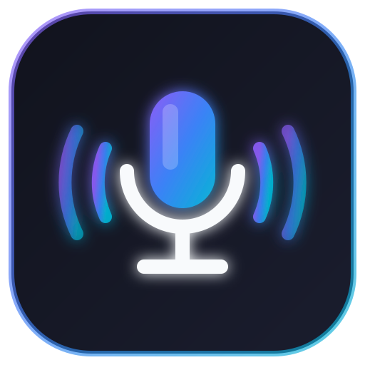
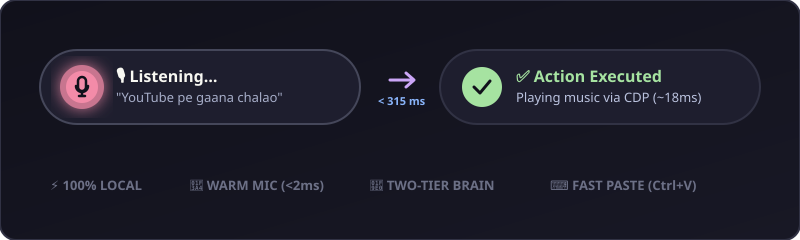

<div align="center">



# 🎙️ Remi Suite

### *Local-first voice assistant & dictation for Windows*

[](https://python.org)
[](LICENSE)
[](https://microsoft.com/windows)
[](https://github.com/ggerganov/whisper.cpp)

**Control your browser and dictate into any app with your voice, in English, Hindi, and Hinglish.**
*Everything runs locally — your voice never leaves your machine.*

[Getting Started](docs/getting-started.md) • [Architecture](docs/architecture.md) • [Voice Commands](docs/commands.md) • [Changelog](CHANGELOG.md)

<br/>



</div>

---

## What it does

Two voice apps, one shared local engine:

| App | Hotkey | What it does |
|---|---|---|
| **Remi Browser** 🌐 | `Ctrl+Alt+B` | Voice-controlled browser — 40+ commands for navigation, tabs, scrolling, clicks, and media, with spoken confirmations |
| **Voice Trans** 🎙️ | `Ctrl+Alt+Space` | Push-to-talk dictation into whatever app has focus |

## Highlights

- **Fast**: ~315 ms total turnaround, down from ~1,645 ms (benchmarked on an RTX 4050 laptop). A persistent whisper.cpp server keeps the model warm — ~0.3 s on CUDA, CPU fallback included.
- **Private by design**: local transcription, local LLM (Ollama / LM Studio / llama.cpp), no cloud, no account.
- **Remembers context**: SQLite memory across the last 10 turns, so "open that again" just works.
- **Modern extras**: desktop HUD pill, wake word detection, voice-activity detection, Kokoro Hindi/Hinglish neural TTS, a local REST API (`remi serve`), and modular skills — including a Hinglish morning digest and voice control for Calculator and Notepad.

## Quick start

**One-click installer** — double-click [`scripts/setup.bat`](scripts/setup.bat), or in PowerShell:

```powershell
powershell -ExecutionPolicy Bypass -File scripts\setup.ps1
```

**Or install manually:**

```bash
git clone https://github.com/gour4v97/remi.git
cd remi
pip install -e .

remi setup          # interactive setup wizard (models, CUDA, shortcuts)
remi model download large-v3-turbo-q5_0   # recommended model (~574 MB)

remi start          # Remi Browser (Ctrl+Alt+B)
remi dictation      # Voice Trans (Ctrl+Alt+Space)
```

## Try saying

```text
"open youtube"        -> Opens YouTube
"niche jao"           -> Scrolls down (Hinglish)
"tab band karo"       -> Closes the active tab
"gaana chalao"        -> Plays media on the page
"what time is it"     -> Spoken offline time answer
```

Full list: [docs/commands.md](docs/commands.md)

## How it's built

Five composable parts — `speech`, `engine`, `tools`, `agents`, `core` — with a registry and event bus holding them together. Details: [docs/architecture.md](docs/architecture.md)

Useful commands: `remi doctor` (system diagnostics), `remi serve` (local REST API), `remi llm` (local model backends), `remi skill` (custom skills), `remi bench` / `remi eval` (benchmarks).

## Development

```bash
make dev-install   # install with dev dependencies
make test          # run the test suite
make format        # format code
make lint          # lint code
```

## License

Distributed under the **MIT License**. See [LICENSE](LICENSE) for details.
