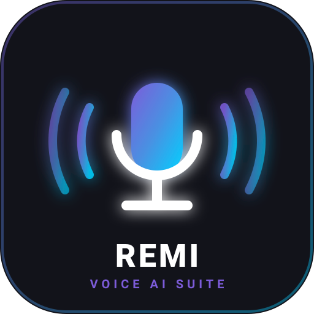
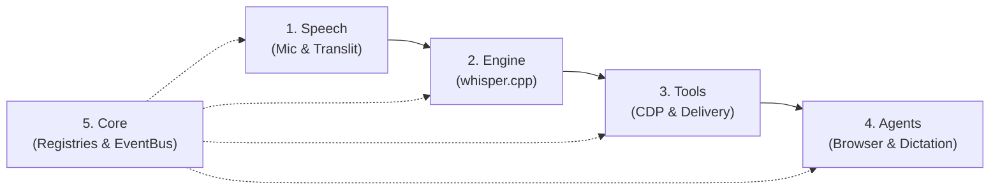

<div align="center">



# 🎙️ Remi Suite

### *Local-First, Offline Voice Assistant & Dictation Suite for Windows*

[](https://python.org)
[](LICENSE)
[](https://microsoft.com/windows)
[](https://github.com/ggerganov/whisper.cpp)
[](docs/architecture.md)

**Control your browser and dictate into any application using your voice in English, Hindi, and Hinglish.**  
*Everything runs 100% locally on your machine — your voice data never leaves your device.*

[Getting Started](docs/getting-started.md) • [Architecture](docs/architecture.md) • [Voice Commands](docs/commands.md) • [Changelog](CHANGELOG.md)

</div>

---

## ⚡ Overview

**Remi Suite** provides two zero-cloud voice applications powered by a shared, persistent local inference engine:

| Application | Trigger | Description | Output |
|---|---|---|---|
| **Remi Browser** 🌐 | `Ctrl+Alt+B` | Voice-controlled web browser via Chrome DevTools Protocol (CDP) | Navigation, tabs, scrolling, clicks, media + spoken confirmation |
| **Voice Trans** 🎙️ | `Ctrl+Alt+Space` | Push-to-talk universal dictation into any focused window | Types text via Win32 Unicode `SendInput` or copies to clipboard |

```
[HotKey] ──> 🎤 16kHz Mic ──> 🧠 Persistent whisper.cpp (CUDA: ~0.3s) ──> 🔤 Hinglish Normalizer ──> 🖥️ Action / Typing ──> 🔊 Spoken Confirmation
```

---

## 🏛️ Architecture: 5 Composable Pillars

Modeled after the composable architecture of Stanford's **OpenJarvis**, Remi is decoupled into 5 distinct pillars:



1. **`speech`** (`src/remi/speech/`): 16 kHz audio capture (`MicCapture`), Devanagari-to-Roman transliteration (`to_roman`), and low-latency SAPI TTS synthesis.
2. **`engine`** (`src/remi/engine/`): Persistent HTTP `whisper.cpp` server with automatic NVIDIA CUDA acceleration and one-shot CLI fallback.
3. **`tools`** (`src/remi/tools/`): Chrome DevTools Protocol automation client, 40+ command natural grammar router, Win32 SendInput Unicode keyboard delivery, and JSONL audit logging.
4. **`agents`** (`src/remi/agents/`): User-facing Windows system tray agents (`BrowserVoiceAgent`, `DictationAgent`).
5. **`core`** (`src/remi/core/`): Generic decorator-based registry (`RegistryBase`), decoupled pub/sub event bus (`EventBus`), and typed TOML configurations.

---

## 🚀 Quick Start & One-Click Setup

### One-Click Installer (Windows)

Simply double-click [`scripts/setup.bat`](scripts/setup.bat) or run in PowerShell:

```powershell
powershell -ExecutionPolicy Bypass -File scripts\setup.ps1
```

This will automatically:
- Install Python dependencies
- Run the interactive hardware & model wizard
- Create double-clickable **Remi Browser** and **Voice Trans** shortcuts on your Desktop!

---

### Manual Installation & Setup Wizard

```bash
git clone https://github.com/gour4v97/remi.git
cd remi
pip install -e .

# Launch interactive setup wizard (models, CUDA, shortcuts)
remi setup
```

### 2. Download Whisper Model

Remi downloads self-contained `whisper.cpp` binaries automatically on first use. Download the recommended model weights:

```bash
# Download recommended balanced model (~574 MB)
remi model download large-v3-turbo-q5_0

# (Optional) If you have an NVIDIA GPU, download the CUDA build for ~80x speedup:
remi model download-cuda
```

### 3. Run Applications

```bash
# Launch Remi Browser Voice Controller (Ctrl+Alt+B)
remi start

# Launch Voice Trans Dictation Tray App (Ctrl+Alt+Space)
remi dictation
# or: voice-trans
```

---

## ⌨️ CLI Reference

Remi includes a comprehensive Click-based CLI:

```bash
remi --help

Commands:
  setup      Launch interactive hardware & model setup wizard
  init       Alias for 'remi setup' (OpenJarvis style)
  start      Start Remi browser voice controller tray app (Ctrl+Alt+B)
  dictation  Start Voice Trans push-to-talk dictation tray app (Ctrl+Alt+Space)
  serve      Start Remi local REST API server (port 8765)
  say        Execute a command directly from text (e.g. remi say "open youtube")
  say-audio  Execute a command from a WAV file (e.g. remi say-audio test.wav)
  doctor     Run local system diagnostics (GPU, CUDA, models, browser CDP)
  llm        Manage local SLM/LLM backends (Ollama, LM Studio): status, ask
  skill      Manage modular custom skills: list, path
  model      Manage models: list, download <name>, download-cuda, set <name>
  history    View recent execution audit history
  autostart  Manage Windows login startup: remi autostart [on|off|status]
```

### Diagnostics with `remi doctor`

Verify your local system setup with a single command:

```bash
remi doctor
```

```text
=== Remi System Health Check ===
Python version : 3.12.3
Config path    : C:\Users\User\AppData\Roaming\remi-suite-py\remi-py.toml
NVIDIA GPU     : Detected
CUDA build     : Installed
whisper-cli    : Installed
whisper-server : Installed
Active model   : large-v3-turbo-q5_0 -> FOUND
Browser exe    : C:\Program Files\Google\Chrome\Application\chrome.exe
Browser CDP    : ACTIVE on port 9222
================================
```

---

## 🎯 Command Grammar & Hinglish Support

Remi supports natural phrasing in **English**, **Hindi**, and **Hinglish**:

```text
"open youtube"           -> Opens YouTube
"youtube lofi beats"     -> Searches YouTube for lo-fi beats
"scroll down"            -> Scrolls page down 600px
"niche jao"              -> Scrolls page down (Hinglish)
"tab band karo"          -> Closes active tab
"naya tab kholo"         -> Opens new tab
"gaana chalao"           -> Plays media on current page
"volume badhao"          -> Increases volume by 10%
"what time is it"        -> Spoken offline time answer
"aaj ki tarikh"          -> Spoken offline date answer
```

See [docs/commands.md](docs/commands.md) for the complete list of 40+ supported commands.

---

## ⚡ Performance: CPU vs NVIDIA GPU

Remi uses a **persistent in-memory whisper.cpp HTTP server** so the model remains warm in RAM/VRAM:

| Mode | Hardware | Transcription Latency |
|---|---|---|
| **NVIDIA CUDA** 🚀 | RTX 3050 / 4050 or higher | **~0.3 seconds** |
| **CPU Fallback** | Intel / AMD Multi-Core | **~10 - 25 seconds** |

---

## 🛠️ Development & Testing

```bash
# Install with dev dependencies
make dev-install

# Run test suite
make test

# Format code
make format

# Lint code
make lint
```

---

## 📄 License

Distributed under the **MIT License**. See [LICENSE](LICENSE) for details.
