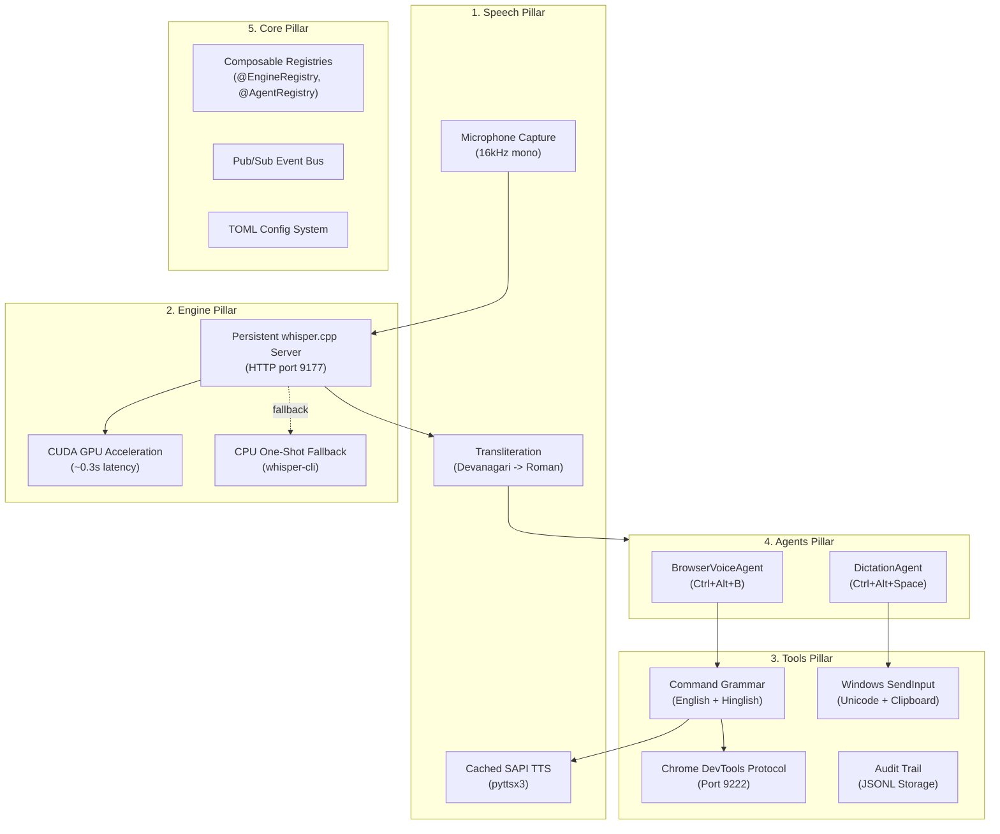

# 🏛️ Remi Architecture & Design

Remi Suite is architected around **5 composable primitives** inspired by Stanford's OpenJarvis framework:

---

## 1. Engine Pillar (`src/remi/engine/`)
Provides local offline speech-to-text and language model intelligence:
- **`WhisperCppEngine`**: Self-bootstrapping whisper.cpp HTTP daemon. The server loads model weights once and stays warm in memory. Transcriptions complete in ~0.3s on NVIDIA CUDA GPUs.
- **`Local SLM/LLM Engine` (`OllamaEngine`, `OpenAICompatEngine`)**: Pluggable inference backends connecting to Ollama, LM Studio, llama.cpp, or vLLM on localhost.
- **`IntentResolver`**: Automatic fallback for complex or conversational speech commands. Classifies user intent into structured JSON actions (`open_url`, `search`, `speak`) when grammar rules do not match.
- **Auto-Discovery (`detect_environment`, `auto_detect_llm`)**: Automatically detects NVIDIA GPUs, CUDA build presence, downloaded GGML models, whisper servers, and local LLMs.
- **Fail-Safe Fallback**: If the HTTP server is unreachable or fails to boot, it falls back seamlessly to the one-shot `whisper-cli.exe`.

## 2. Speech Pillar (`src/remi/speech/`)
Handles audio ingestion, signal formatting, and voice feedback:
- **`MicCapture`**: Samples audio at 16 kHz mono signed 16-bit PCM. If a hardware device refuses 16 kHz, it records at the native rate and performs linear resampling upon stop.
- **`translit`**: Transliterates Devanagari script into phonetic Roman script (Hinglish), and converts spoken punctuation into formatted text (`smart_writing`).
- **`SapiTTS`**: Cached Windows SAPI speech synthesizer for near-zero-latency audio feedback.

## 3. Tools Pillar (`src/remi/tools/`)
Executes real-world computer interactions:
- **`BrowserClient`**: HTTP and WebSocket bridge to Chrome and Microsoft Edge via Chrome DevTools Protocol. Evaluates JavaScript, manages tabs, clicks DOM elements, and scrolls viewports.
- **`CommandRouter`**: Grammar matching 40+ voice commands in both English and Hinglish. Supports domain navigation, YouTube searches, volume, zoom, media toggle, and offline instant time/date answers.
- **`DeliveryService`**: Win32 `SendInput` Unicode typing engine with clipboard recovery guarantee and guarded window-focus detection.
- **`HistoryStore`**: Thread-safe append-only JSONL log with execution timings and outcome status.

## 4. Agents Pillar (`src/remi/agents/`)
User-facing agents living in the Windows system tray:
- **`BrowserVoiceAgent`**: Triggered via `Ctrl+Alt+B`. Listens, transcribes, interprets commands, executes browser actions, and speaks audio confirmation.
- **`DictationAgent`**: Triggered via `Ctrl+Alt+Space`. Push-to-talk dictation with customizable replacement dictionaries and delivery modes (type, clipboard, guarded).

## 5. Core Pillar (`src/remi/core/`)
Underlying infrastructure:
- **`RegistryBase[T]`**: Decorator-based registry allowing runtime discovery of engines, agents, tools, speech pipelines, and TTS providers.
- **`EventBus`**: Decoupled pub/sub event bus emitting lifecycle, transcription, and command events.
- **`Config`**: TOML configuration parser with typed dataclasses and cross-platform path fallbacks.
